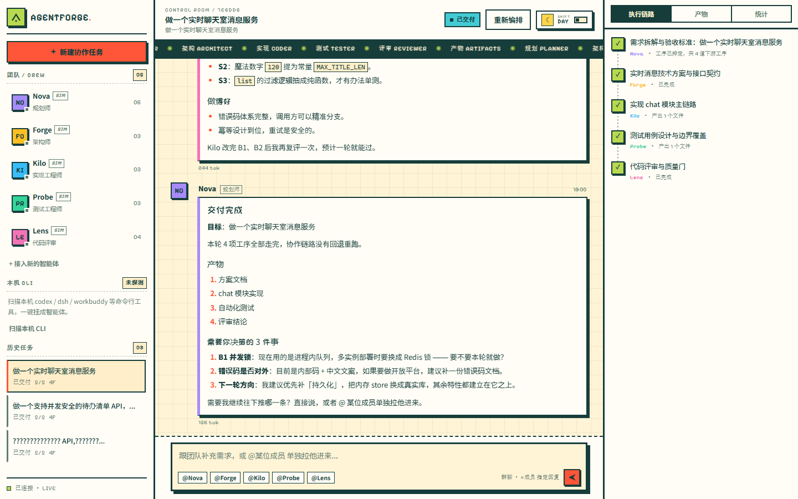

<div align="center">

# AgentForge

**一句话需求，一支会协作的 AI 研发团队。**

规划 · 架构 · 实现 · 测试 · 评审 全流程自动编排：先讨论出方案，再并行落代码，真实跑一遍测试，评审不通过自动返工。产物落在真实工作区，过程在浏览器里逐字可见。

[](https://nodejs.org)


[快速开始](#快速开始) · [工作原理](#工作原理) · [接入本机-cli](#接入本机-cli) · [上下文预算](#上下文预算) · [工作区与工具](#工作区与工具策略) · [HTTP-API](#http-api) · [文档导航](#文档导航) · [常见问题](#常见问题)



</div>

---

## 当前版本

本轮把“多智能体协作”推进到可追踪、可重规划、可审计的平台基线，并补齐 M3 / M4 / M5 的身份、工作区、生产可观测性与多实例能力：

AgentForge 当前定位是**单机 / 团队服务基线**：一个 Node.js 进程即可运行，多个实例可以共享同一 JSON 数据目录并通过文件锁和租约协调。它不是分布式任务队列，也不是完整 SaaS；账号、RBAC、SSO、外部数据库和内核级 CLI 隔离仍在后续范围。

- **真实质量门**：CLI 与模拟任务都执行工作区测试入口；没有入口、执行失败、超时、或「退出码 0 但输出没有 pass/fail 证据」都不能交付；`exit 0` / `true` / 纯 echo 这类占位脚本不算测试入口。测试子进程只继承最小环境白名单，Provider 密钥不会进入测试命令。每次记录真实命令、退出码、耗时、输出、改动范围（是否动过测试文件）和通过/失败计数。
- **项目技能注入**：从工作区、源工作区与用户级 `.agents/skills/*/SKILL.md` 装载技能，按触发词或 Agent 显式标签激活，注入提案、质询、裁决、工序、收口与聊天 prompt；激活记录会出现在 `/api/state`、任务详情和界面上下文中。
- **运行记录导出**：`GET /api/tasks/:id/export?format=markdown|html` 导出质量门、计划、技能激活、协作消息、事件、产物与讨论记录，敏感值会脱敏。
- **结构化评审结论**：评审必须输出扁平 JSON `VERDICT`，缺失、损坏或与 Blocker 矛盾的结论都不能放行；Blocker / Should 数量会进入工序记录和界面。
- **独立评审**：评审候选只允许 `reviewer / tester / architect`，实现者不会被悄悄拉来审自己；自审按真实 `reviewerId / implementerId` 判定并写入任务事件。
- **服务安全边界**：默认回环地址可零配置启动；绑定到局域网或其他非回环地址时强制要求 `AGENTFORGE_API_TOKEN`，也可显式接受无鉴权风险。支持 Bearer、`X-AgentForge-Token`、浏览器 SSE 查询令牌、同源 / CORS 白名单和拒绝审计。
- **统一 trace / span**：任务事件自动带 `traceId / spanId / parentSpanId / kind / runId`，运行根 span 写入任务详情；界面、`/api/state`、任务详情和 Markdown / HTML 导出都可追踪一次运行。
- **Automation / 定时任务**：支持周期与每日计划、启停、立即运行、最近历史、失败重试、重叠运行阻止、启动恢复和 durable `await_event`；调度器只在本进程内运行，不伪装成分布式队列。
- **上下文压缩与回放**：达到阈值可自动压缩，保留来源消息范围、摘要质量、历史记录和原文回放；当前摘要是**抽取式**，不是模型生成的语义摘要。压缩记录进入 `/api/state`，原始消息不删除。
- **图片附件**：Provider Profile 需声明 `vision` 能力；只接收 PNG / JPEG / WebP / GIF，校验体积、尺寸和像素，按内容寻址保存，持久化数据不内联 base64 或本地绝对路径。自动测试覆盖类型、体积、尺寸、存储和视觉能力门禁；不同外部 CLI 的真实视觉端到端仍需逐项验收。
- **重启恢复**：服务重启时把遗留的 queued / running 任务标为中断并写入 `run.recovered` 事件；已发出的 Automation 结果会重新对齐，不留下幽灵排队任务。
- **任务优先级**：任务支持 `low / normal / high`，队列按优先级出队、同优先级保持 FIFO；选择器和任务列表会显示优先级，旧任务自动按 `normal` 迁移。
- **增量持久化**：流式消息在 200ms dirty 窗口内合并落盘，只重新序列化变化任务；进程正常退出前会 flush 未完成窗口。
- **CLI 解析缓存**：命令解析走进程级缓存，PATH 变化时由探测/刷新接口显式失效，减少热路径同步调用。
- **动态工序图**：规划师根据任务形状输出 DAG，平台校验后替换模板；纯 bug 修复可省略设计工序，多模块可拆给多个 coder。默认开启，非法计划回退模板并写 `plan.fallback`。
- **计划版本**：初版、返工和手动重规划都会生成不可变快照，已完成工序不会被重规划抹掉；自动重规划最多一次，避免无限重试。
- **消息路由**：每条协作消息记录来源、目标、父消息、关联工序、产物引用和 `correlationId`。
- **Tool Gateway 第一层**：平台 API 统一校验工具白名单、执行主体和工作区边界，并记录 `tool.call.start` / `tool.call.end` / `tool.policy.denied`。
- **CLI 执行策略网关**：`strict` 模式把工具白名单映射到 Codex / DSH / Claude 的原生沙箱或工具白名单；无法强制的组合在启动前拒绝，并记录 `cli.policy.*`。
- **多视图工作区控制台**：文件、执行轨迹、计划版本、协作消息、工具审计、DAG、回放、总览与 Diff 在同一工作区中查看。
- **文件夹开工**：可从本机目录选择器选择已有项目，或使用 Git 隔离工作树并行开工；当前构建已用真实浏览器验收目录进入、返回、中文与空格路径，缺少 Edge 时显式跳过浏览器用例。
- **M3 平台边界**：owner / operator / agent / system 主体与 Token 作用域、Provider 用量账本、可审计上下文压缩、历史检索、`clientMessageId` 幂等、只读 MCP 网关和一次性命令审批。
- **M4 工作区能力**：可复用 Agent Profile、默认不跨任务的工作区池、读后写版本守卫、事务回滚、DAG 图、时间回放和跨任务总览。
- **M5 生产化**：按租户过滤任务 / Automation / 审批并执行任务配额、OTLP trace 导出、`db.json` 文件锁与任务 / Automation / Provider 槽位租约、任务分片持久化、目录懒加载和 `/api/state` cursor 分页。

## 为什么会有这个项目

把需求丢给单个 AI CLI，你会遇到三个反复出现的坑：

| 坑 | 表现 | AgentForge 的做法 |
| --- | --- | --- |
| **没有分工** | 一个模型既当架构师又当测试，自己审自己 | 5 个角色席位各司其职，评审与实现分离 |
| **不做方案比较** | 第一个念头就是最终方案，硬伤留到交付后 | 先辩论：多方案并行提案 → 交叉质询 → 主持人裁决 |
| **只说不做** | 聊出一堆代码块，没人真正写文件、跑测试 | 每个工序都在真实工作区执行，产物与版本可查 |

而市面上多数「多智能体框架」是**演示品**：内置几个模拟角色，输出像模像样，落到磁盘上是空的。AgentForge 反过来——**默认就用你本机已经装好、真的跑得通的 CLI**，模拟只作为「一个都连不上」时的显式回退，并且每个成员都挂着 `SIM 演示` / `✓ CLI 可用` 徽标，绝不把假输出当成交付。

## 特性

**编排**

- 🧠 **方案辩论先行** — 4 个执行席位 + 1 个工具池 CLI 各出一版方案（契约先行 / 最小闭环 / 测试先行 / 风险优先 / 分阶段交付），互相匿名打 1–10 分并各指一个硬伤，主持人按平均分裁决；只有 1 份有效提案或评分不足时会在裁决里标注置信度，不假装形成共识。
- 🔀 **依赖图并行** — 架构定稿后「实现」与「测试设计」并行推进，DAG 校验依赖与环路，失败按依赖链传播，取消是即时生效而不是等当前工序跑完。
- 🧭 **规划师动态 DAG** — `plan` 工序先单独执行，规划师按任务形状输出工序图；平台校验后应用并保留已完成的 `debate / plan`。同一 Agent 串行、不同 Agent 可并行，非法图回退模板并写 `plan.fallback`。
- 🚦 **真实质量门** — 评审前真的执行测试命令，结构化 `VERDICT` 判为 PASS 且质量门 `passed` 才允许交付；FAIL 进入「修复 → 回归 → 复评」有界回环，轮次可配。测试入口按 `package.json scripts.test` → Makefile `test` → pytest 配置 → Cargo → Go → `tests/` 探测；占位脚本（`exit 0`、`true`、纯 echo、`no test specified`）会被跳过；没有入口标为 `no-test-entry`，失败、超时或无 pass/fail 证据同样阻断交付。每次记录真实命令、来源、退出码、耗时、stdout/stderr、证据来源和改动范围，真实 CLI 任务也走同一套质量门。
- 🧩 **项目技能与用户技能** — 自动发现 `.agents/skills/*/SKILL.md`，支持 `name / description / triggers / roles / always / enabled` 前置字段；工作区技能覆盖源工作区与用户级同名技能。技能只注入提示词，不执行脚本，也不能绕过工具权限、质量门或用户目标。
- 🧾 **可审计运行记录导出** — Markdown 适合归档和代码评审，HTML 适合直接打开阅读；导出前统一脱敏 API Key、Token、密码和 Bearer 凭据，并转义 HTML。
- ✅ **结构化评审协议** — 只接受 `VERDICT: {"decision":"PASS|FAIL","blockers":0,"should":0}`；旧的自然语言 `VERDICT: PASS` 不再静默放行，`PASS` 携带 Blocker 也会被判为无效。
- 🧑‍⚖️ **独立评审** — 评审候选只允许 `reviewer / tester / architect`，实现者绝不会被悄悄拉来审自己；只有实现席位时评审明确不可用。若历史或人工配置仍造成自审，真实 `reviewerId / implementerId`、`selfReview` 和 `review.independence` 事件会把它暴露出来。
- 🎛 **工作流可视化配置** — 讨论开关与规模、动态计划、工序上限、工序并发、全局任务并发、返工轮次都在顶栏 ⚙ 里改，即时落库；另带「快速 / 均衡 / 严谨」三档预设。「快速」显式关闭动态计划。
- 🔁 **任务级流程覆盖** — 输入框旁可切「先讨论」或「直接开工」，只影响当前任务，不动全局默认。
- 🧭 **计划版本与有限重规划** — 计划以不可变快照保存；失败后自动重规划最多一次，手动重规划会保留已完成工序，方便在复杂项目中继续推进。
- 🧱 **动态计划审计** — 合法计划写 `plan.generated`，校验失败写带原因的 `plan.fallback`，返工与重规划写 `plan.replanned`；计划版本、工序绑定和产物归属都能从任务详情与 `/api/state` 追溯。
- 🔗 **带路由的协作消息** — 消息不再只是聊天记录，还带来源、目标、父子关系、关联工序和产物引用，方便定位“谁把什么交给了谁”。
- 🧰 **Agent 工具白名单与 Tool Gateway** — 每个成员声明可用工具，角色有默认策略，也能按成员覆盖；平台 API 会按 `agentId` 校验权限并写入工具审计。
- 🛡 **真实 CLI 强制策略** — `strict` 会从工具集合推导只读 / 可写边界，覆盖 CLI 参数里的危险沙箱开关；Codex、DSH 映射原生沙箱，Claude 仅允许无 shell 的只读工具白名单，其他组合明确拒绝。
- 🌳 **Git 隔离工作区** — 每个任务可在独立 detached worktree 中执行；Windows 文件系统无法写 worktree 元数据时自动回退 shared clone，源仓库不受影响。
- 🧱 **可复用 Profile 与工作区池** — Profile 组合角色、技能、工具、MCP、Provider、模型、并发和工作区策略，可导入导出且不含密钥；跨任务 `Shared/` 或 Agent 私有目录必须显式开启，默认保持任务隔离。
- 🔒 **读后写与事务回滚** — 修改已有文件必须提交最近读取版本，陈旧写入返回冲突并留痕；批量移动、删除和写入可作为单个事务提交，失败时回滚真实文件与元数据。

**执行**

- 🖥 **本机 CLI 体检接入** — 内置候选覆盖 15 个常用 CLI；启动默认只做本地存在性 / 版本 / 配置探测，**不发起真实提示词调用**，只有点「体检并换席」或 `POST /api/team/refresh` 才并发体检已安装项，只有「真回了话且没有鉴权错误」的才占执行席位，同一个 CLI 可兼任多角色（`OpenCode · 架构师`）。体检复用已绑定 Agent 的 Provider Profile，参数模板、Base URL、模型和密钥环境引用会进入真实子进程；仓库自动测试验证调用契约、Provider 注入、Windows `.cmd` 与进程路径，不等于本机已安装并授权全部 15 个 CLI。
- 🔎 **CLI 解析缓存** — `resolveCommand()` 缓存命令解析结果，避免每次调用都同步跑 `where.exe` / `which`；探测或刷新团队时显式失效，带参数的命令串也能正确提取可执行文件。
- 🔌 **Provider Profile、参数模板与自动回退** — 每个 Agent 可绑定独立 Provider Profile，保存 Base URL、模型、密钥环境变量引用、CLI 参数模板和并发上限；可配置有序备用 Provider，真实 CLI 失败后自动切换并把 `provider.fallback` 写入任务事件流。密钥只从服务进程环境读取，不写入 `db.json`。
- 🧾 **产物带内容版本** — 每个产物记录 `version`（sha256 前 16 位），改写即换版本，可判断「这一步到底动了什么」。
- 🧷 **不合格输出不流转** — 每个角色的回复都要过结构校验：提案需 5 段标题、质询需覆盖全部方案、步骤需可执行产出；半截回复或「我无法完成」直接重试，不把残稿喂给下一步。
- 💾 **任务分片持久化** — 每个任务独立落 `data/tasks/<id>.json`（临时文件 + 原子替换），`tasks/index.json` 是可按目录重建的索引，`db.json` 只保留 agents / profiles / providers / settings 并维持五键兼容形状。旧版内联任务在首次加载时自动迁移并备份为 `db.json.bak`；损坏的分片会被跳过而不是让整个库加载失败。流式输出仍在 200ms dirty 窗口内合并写盘，只写变化任务的分片。
- 🧩 **零依赖多实例** — 同一数据目录可由多个进程共享：写盘走 `.db.lock` 合并，任务和 Automation 使用 `.leases.json` 租约避免重复执行。Automation / Scheduler 仍是进程内调度器，不是分布式队列。

**界面**

- ⚡ **SSE 实时流** — 逐字输出、Markdown / 表格 / 代码块渲染、阶段条实时高亮、点击工序跳到对应时间线。
- 🗂 **三栏工作台** — 左栏席位与历史，中栏时间线与群聊，右栏上下文 / 辩论记录 / DAG / 产物源码。
- 🖥 **全屏工作区控制台** — 文件树 / 搜索 / 预览 / 编辑、按 Agent 分组的执行泳道、DAG 图、时间回放、跨任务总览、Git diff、上下文预算和工具策略在同一屏查看。
- 🌗 **两套配色** — 顶栏 `SHIFT` 切换日间与夜间。
- 🪟 **桌面模式** — 不打包 Electron，用系统浏览器 `--app` 模式得到独立窗口与任务栏图标，双击即用。

**工程**

- 📦 **零依赖、零构建** — 纯 Node.js + 原生 ESM，`node server/index.mjs` 就起来，前端不打包、不装包管理器。
- ✅ **统一验证入口** — `npm test` 统一设置隔离数据目录后运行真实测试；`npm run check:syntax` 检查全部 `.js/.mjs`；`npm run check:types` 是零依赖 JSDoc/语法门（`@param` 必须匹配签名、返回值必须带类型）；`npm run test:coverage` 对核心模块跑覆盖率并强制 lines ≥ 40%、functions ≥ 35%。覆盖范围按领域列在下方[测试](#测试)章节。

## 快速开始

要求 **Node.js ≥ 20.11**，没有任何其他依赖。

```bash
# GitHub（主仓）
git clone https://github.com/liuzheng6621/super-agentbot.git
# Gitee（国内镜像，内容同步）
# git clone https://gitee.com/liu-everything_impossble/super-agentbot.git
cd super-agentbot
npm start
```

打开 <http://127.0.0.1:8787>，在底部输入框描述需求，`Ctrl / ⌘ + Enter` 开工。

首次启动会自动生成：

```
data/db.json                 团队、设置、Webhook Token（不含任务）
data/tasks/<id>.json         任务分片，单任务原子写
data/tasks/index.json        分片索引，缺失或过期时自动重建
data/workspaces/<taskId>/    每个任务的真实工作区（产物就在这里）
data/spill/<taskId>/         超长上游产物的落盘副本
data/attachments/<sha前两位>/<sha>.<ext>
                             图片附件的内容寻址副本
```

> **Windows 一键**：双击 `安装到桌面.bat`，桌面与开始菜单会出现 `AGENTFORGE` 快捷方式，双击开窗、关窗回收。

## 工作原理


每一轮工序都走同一条链路：

```
组装上下文（稳定区 + 易变区） → 调 CLI（真实子进程） → 抓 stdout
   → 对比工作区快照（size + 纳秒 mtime + 内容版本） → 收录产物 → 落 Session 事件
```

动态计划模式在 `plan` 完成后先解析规划师输出末尾的 JSON 工序图，校验角色、依赖、路径和唯一终端 reviewer，再替换未完成工序。模板计划始终保留为兜底；关闭开关或规划非法时不会带病执行。

### 五个执行席位

| 角色 | 职责 | 典型产出 | 默认偏好顺序 |
| --- | --- | --- | --- |
| `planner` | 拆需求、排工序、收口 | 任务分解、交付结论 | claude → dsh → qwen → gemini |
| `architect` | 技术方案、接口契约 | 设计文档 | gemini → claude → dsh → kimi |
| `coder` | 落代码、写文件 | 源码文件 | codex → opencode → trae-cli → dsh |
| `tester` | 用例矩阵、回归验证 | 测试用例、缺陷单 | opencode → crush → codex → gemini → dsh |
| `reviewer` | 评审、PASS / FAIL 质量门 | 评审意见 | dsh → claude → kimi → qwen → gemini |

评审独立性按 Agent、Provider、模型和 CLI 共同判定：同一 Agent 或同一 Provider + 同一模型都记为 `self-review`，写入任务事件并在统计面板提示，不再当成独立评审。

席位采用 **主执行人 + 工具池**：每个角色只有一个主执行人，多接的 CLI 留在池里随时可上位。角色可增删改，提示词、命令、参数都能在界面上编辑。

## 接入本机 CLI

左栏「扫描本机 CLI」用 `where.exe` / `which` 确认命令存在并读版本。**启动时只做本地存在性、版本和配置探测，不发起真实提示词调用**；只有点「体检并换席」或 `POST /api/team/refresh`、`POST /api/team/ensure` 才会对已安装 CLI 真发一条最短提示词（`Reply with exactly: OK`），判定标准是「有回复 + 没有鉴权错误」，而不是「进程退出码为 0」——因为很多 CLI 失败时也返回 0。体检结果按命令名缓存，下次启动直接复用。

下表是**内置候选与调用契约**，记录当前适配参数、prompt 传递方式和历史 Windows 体检耗时。它不代表每台机器、每个版本都已安装并授权；外部 CLI 的安装、Provider 配置和一次真实交付仍要逐项验收。

| CLI | 调用方式 | 免审批参数 | prompt 传递 | 历史 Windows 体检耗时 |
| --- | --- | --- | --- | --- |
| `claude` | `.exe` 直连 | `--permission-mode bypassPermissions` | argv | ≈ 7s |
| `codex` | `.exe` 直连 | `--sandbox workspace-write` | argv | ≈ 17s |
| `opencode` | `.cmd` | `run --auto` | stdin | ≈ 11s |
| `cursor-agent` | 命令直连（平台解析） | `-p` | argv | — |
| `copilot` | 命令直连（平台解析） | `-p` | argv | — |
| `cn` | 命令直连（平台解析） | `-p` | argv | — |
| `dsh` | `.cmd` | `--permission-mode workspace-write --approval-policy never` | stdin | ≈ 30s |
| `kimi` | `.cmd` | —（打印模式不接受 `--auto`） | argv | ≈ 8s |
| `trae-cli` | `.exe` 直连 | `run --config-file …` | argv | ≈ 14s |
| `crush` | `.exe` 直连 | `run -y` | stdin | ≈ 28s |
| `goose` | 命令直连（平台解析） | `run -t` | argv | — |
| `aider` | `.exe` 直连 | `--yes` | argv | ≈ 16s |
| `gemini` | `.cmd` | `--skip-trust --approval-mode yolo` | stdin | ≈ 7s |
| `qwen` | `.cmd` | `--approval-mode yolo` | stdin | ≈ 20s |
| `ollama` | 命令直连（平台解析） | `run qwen2.5-coder` | argv | — |

仓库自动测试覆盖调用契约、Provider Profile 注入、Windows `.cmd` 参数、stdin、超时和进程回收；这些测试使用受控夹具，不等于真实外部 CLI 的完整交付矩阵。

三条踩过的坑，写在这里省你几小时：

1. **非交互必须显式免审批**。`-p` / `exec` 模式下没有人在旁边点「允许」，写文件会被权限层拦下，模型会回一句「我无法绕过权限」然后什么都没做。
2. **`.cmd` 包装器经 `cmd.exe` 时，多行 prompt 的换行会被当成命令分隔符**，后面的参数被吞掉（典型症状：`gemini` 报 `not running in a trusted directory`、退出码 55）。所以 `.cmd` 系一律把 prompt 走 **stdin**，只有 `kimi` 因为 `-p` 与 `--auto` 互斥而保留 argv——代价是它只适合单行任务。
3. **「装了」≠「能用」**。装了没配 Key、网关返回 405、provider 未初始化，都会在体检里被判不可用，不会混进团队。

常见不通过的对照表：

| 体检输出 | 原因 | 处理 |
| --- | --- | --- |
| `API Error: 405 / 401` | 网关地址或凭据不对 | 修正该 CLI 的 base URL / Key |
| `Please set an Auth method` / `No auth type` | 未配置 API Key | 补 `GEMINI_API_KEY`、qwen 的 `--auth-type` 等，再点「体检并换真实席位」 |
| `No providers configured` / `No LLM` | provider 未初始化 | 先跑一次该 CLI 的交互式初始化 |
| `Config file not found` | 缺配置文件 | 用 `--config-file` 指定，或写进参数模板 |
| 超时无输出 | 首次拉模型 / 不支持一次性提示词 | 单独点成员 ⚙ 或 `POST /api/agents/:id/test` 用更长超时复测 |

体检结果写进 `data/db.json` 的 `settings.teamHealth`，二次启动几乎零等待；改了 Key 就点左栏「体检并换真实席位」强制重检。已绑定 Provider Profile 的 CLI 会按该 Profile 的 `cliBindings` 执行体检，不再绕过 Agent 配置直接使用裸命令。

### 调用层的四道兜底

CLI 是不可控的第三方进程，所以调用不是「起进程 → 收字符串」这么简单：

| 机制 | 做法 | 解决什么 |
| --- | --- | --- |
| **参数拼装** | `normalizeCliArgs()` 给 `gemini` 补 `--prompt=`，给 `trae-cli run` 补 `--max-steps 16 --console-type simple`；命令行拼接时逐项加引号 | CLI 参数约定各不相同；路径含空格（`Program Files`）时不会被拆成两个参数 |
| **退出码分类** | `classifyCliExit()` 把退出码映射成 成功 / 执行超时 / 已停止 / 命令缺失 / 启动失败 / Windows 初始化失败（`0xC0000142`）/ 外部终止，并标出是否可重试 | 「退出码 0 = 成功」不成立；`0xC0000142` 这类系统级失败要能和真实业务失败区分 |
| **输出完整性** | `isCompleteProposalText()` / `isCompleteCritiqueText()` / `isCompleteStepText()` / `isCompleteSummaryText()` / `isCompleteDecisionText()` 按角色校验结构（提案需 5 段标题、质询需覆盖全部方案、步骤需可执行产出），不合格自动重试 | CLI 经常「退出码 0 但只回半段」「回一句无法完成」；这种产出若直接进下一步，后面全盘皆错 |
| **运行时 PATH** | `runtimePathEnv()` 把 Node 自身目录与 npm / WinGet / Programs 等常见 bin 目录补进子进程 PATH | 从桌面快捷方式启动时继承的 PATH 残缺，`claude.cmd` 之类会报「找不到命令」 |

### 与 Magpie 的关系

AgentForge **不是基于 Magpie 框架实现**，也不依赖任何特定兼容网关。内置 CLI 候选只保留原生命令、参数与输入方式；Base URL、模型、密钥环境变量引用和 CLI 参数模板统一由 Provider Profile 的 `cliBindings` 注入。

Agent 可以绑定主 Provider 与有序备用 Provider；执行时会解析成临时子进程环境，失败后在同一工序内自动切换，不把明文密钥写回持久化数据。

真实 CLI 的工具边界由 Agent 的 `executionPolicy` 控制：`inherit` 保持兼容，`strict` 会按工具白名单选择 CLI 原生沙箱。当前能可靠表达的组合是 Codex / DSH 的只读或工作区可写沙箱，以及 Claude 无 shell 的只读工具白名单；无法证明的边界会返回 `-6` 并写入 `cli.policy.denied`，不会启动子进程。完整设计见 [docs/agent-platform-roadmap.md](docs/agent-platform-roadmap.md)。

## 上下文预算

多工序流水线最容易悄悄变贵的地方是上下文。这里的四条规则都带测试守护：

| 机制 | 做法 | 为什么 |
| --- | --- | --- |
| **段序稳定** | prompt 拆成 `stableBlock`（目标 / 工作区）与 `volatileBlock`（状态 / 工序账本 / 文件清单）；稳定区永远在前，易变区压到末尾 | 易变块放开头会让**前缀缓存全灭**，每步都按全价重算 |
| **输入输出双向 token 记账** | `server/tokens.mjs` 按字符类估算：CJK 1.0 / ASCII 1/3.6 / 其他 1/2；`store.countPrompt()` 在发请求前先记提示词，`appendMessage()` 记流式输出，落成 `stats.tokensIn` / `tokensOut` | 只算输出会把成本低估一个数量级（实测同一任务输入 4319 / 输出 7187）；用 `len/3` 估中文还会再低估约 3 倍 |
| **原子写 + 内容版本** | `server/fs.mjs`：同级临时文件 → `fsync` → `rename`；`versionOf()` 取 sha256 前 16 位 | 半截文件不可接受；等长改写也要能识别出来 |
| **超长产物 spill** | 上游产物超过 8000 字落 `data/spill/<taskId>/`，prompt 里只放「只读路径 + 1600 字摘录」 | 直接 `clip` 丢掉中间 25% 是**不可恢复**的信息损失 |

设计依据与完整取舍写在 [docs/design-io-image-context.md](docs/design-io-image-context.md)。

上下文压缩会在达到阈值时保留最近消息和来源范围，把较早内容折叠为可回放的摘要。当前摘要基于抽取与合并，不调用模型生成新的语义摘要；因此它降低上下文体积，但不会替代完整历史或人工评审。

## 工作区与工具策略

工作区控制台不是静态文件列表，而是把“文件、执行、审查”放在同一条任务链路里：

| 视图 | 能做什么 |
| --- | --- |
| **文件** | 浏览工作树、搜索内容、预览文本/二进制状态、编辑保存、新建、移入回收站 |
| **执行泳道** | 按 Agent 分组显示工序、依赖数、运行状态和尝试次数；事件流记录工具调用、文件变更和运行结果 |
| **Diff** | 对比 Git `HEAD`，并补齐未跟踪新文件的 unified diff；敏感、二进制和超限文件有保护 |
| **上下文 / 策略** | 展示注入的消息与文件预算、最近协作、已知文件、工具白名单，以及 `INHERIT / STRICT / BLOCKED` 执行策略状态 |

平台文件操作覆盖查、增、改、移、删，并统一经过 Tool Gateway 第一层：

- 路径必须是工作区内相对路径；拒绝 `..`、绝对路径和符号链接。
- `.git`、`.agentforge` 不允许通过文件 API 直接读写。
- `.env*`、私钥、`.npmrc`、`.pypirc` 等敏感文件禁止预览和平台写入。
- 写入使用临时文件 + `fsync` + `rename`，并记录前后内容版本。
- 删除进入 `.agentforge/trash`，不是不可恢复的硬删除。
- Agent 调用会校验工具白名单，并记录 `tool.call.start` / `tool.call.end` / `tool.policy.denied`；Owner 写操作同样留痕。
- Owner UI 的只读请求不写入工具审计，避免“刷新工作区 → 产生审计事件 → 再次刷新”的反馈循环。
- `executionPolicy=strict` 时，真实 CLI 必须在启动前通过策略预检；Codex / DSH 使用原生沙箱，Claude 使用只读工具白名单，其他命令或无法精确表达的组合返回 `-6`，不会放行。
- 每次 CLI 调用会记录 `cli.policy.start` / `cli.policy.end` / `cli.policy.denied`，消息元数据包含实际策略、沙箱、边界和拒绝原因。
- `executionPolicy=inherit` 仍保留兼容行为：CLI 可以绕过平台 API 使用自身工具，界面会明确标记 `INHERIT`，不把平台 API 校验冒充子进程隔离。
- 平台 `shell` 端点当前明确返回 `501`，不会把未执行的命令伪装成成功。

Git 隔离支持两种模式：

- `worktree`：`git worktree add --detach`，每个任务独立目录，删除任务时只清理工作树。
- `clone`：当 Windows 文件系统无法写 `.git/worktrees` 时自动回退到 `git clone --shared`，并在界面标记 `CLONE 回退`。

同一进程内可以并行运行多个任务，每个任务使用独立工作区。全局 Scheduler 会限制同时运行的任务数，按 Provider 计算并发配额，并为显式声明的 Agent 获取租约；排队任务会显示队列位置和等待原因。Agent 可声明主 Provider 与备用 Provider，CLI 失败会在同一工序内回退并记录事件。

工作区池默认关闭：Profile / Agent 显式设置 `workspacePolicy.crossTask=true` 后才可使用项目根下的 `Shared/` 或 `Agents/<agentId>/`；任务级 worktree 仍优先。跨任务池目录不会被任务删除回收，租约记录在工作区 `.agentforge/pool/leases.json`。平台产物支持 `workspaceQuotaBytes` 配额（默认 `0 = 不限`）和 `workspaceTrashRetentionDays` 回收站保留期；超额写入返回 `413 / workspace-quota-exceeded`，任务详情与 `/api/state` 暴露用量。任务支持 `low / normal / high` 优先级，调度队列按优先级出队、同优先级保持 FIFO；Provider 级费用预算仍未实现。

## 界面

三栏工作台，所有状态由 SSE 推送，无轮询。

| 区域 | 内容 |
| --- | --- |
| **左栏** | 五个执行席位 + 工具池（在线状态、`SIM 演示` / `✓ CLI 可用` / `! 不可用`）、本机 CLI 扫描结果、「体检并换真实席位」、历史任务 |
| **中栏** | 工作流阶段条（讨论 → 拆解 → 架构与实施 → 评审 → 交付，实时高亮负责人，可点击跳转）、按阶段分隔的协作时间线、流式输出、方案 / 质询 / 裁决标签、底部群聊输入框 |
| **右栏** | 上下文包、方案讨论（提案人 / 评分 / 票数 / 胜出方案 / 质询记录）、DAG 链路（依赖 / 并行 / 尝试次数 / 返工）、产物源码、统计与 Bot Hook |
| **全屏工作区控制台** | 左侧工作树与变更；中间视图：文件 / 执行轨迹 / 计划版本 / 协作消息 / 工具审计 / DAG / 回放 / 总览 / Diff；右侧上下文与 Agent 工具策略；桌面和移动端都可直接进入 |
| **统计面板** | 每个数字都来自落库事实：累计 TOKENS = 各成员 token 之和（输入与输出分开记账，`tokensIn` / `tokensOut`，不把成本低估一个数量级）；协作轮次 = 真实调用成员次数 `stats.agentRuns`；产物文件 = 产物清单条数；返工轮次 = `repairRound`；总耗时 = 各工序实际耗时之和（墙钟含排队与重试等待，只作悬浮提示）；质量门 = `passed / failed / timeout / no-test-entry / running / skipped / not-run` 等状态，中断的任务不会永远停在「待执行」 |
| **顶栏** | 状态、⚙ 工作流设置、`SHIFT` 切换配色 |

群聊里一次 `@` 多位成员，会自动组成讨论组出方案——这是「临时开个小会」的最短路径。

## 桌面模式

| 能力 | 实现 |
| --- | --- |
| 无控制台窗口 | `wscript` 隐藏启动 `desktop/launcher.mjs` |
| 独立应用窗口 | Edge / Chrome `--app` 模式，无地址栏、独立任务栏图标 |
| 隔离浏览器配置 | `%LOCALAPPDATA%\AgentForge\browser` |
| 单实例 | 已运行时直接开窗复用，不重复起服务 |
| 退出回收 | 关窗即结束服务并清理运行时锁 |
| 图标生成 | `desktop/make-icon.mjs` 纯 Node 生成 PNG / ICO |

日志在 `%LOCALAPPDATA%\AgentForge\logs\`，业务数据仍在项目内 `data/`。卸载：`卸载桌面快捷方式.bat` 或 `node desktop/install.mjs --remove`。

## HTTP API

所有接口都在 `http://127.0.0.1:8787` 下，JSON in / JSON out。默认只监听本机回环，因此本地零配置即可使用；绑定非回环地址时必须设置至少 16 个字符的 `AGENTFORGE_API_TOKEN`，或显式设置 `AGENTFORGE_ALLOW_INSECURE_REMOTE=1` 接受风险。

启用服务 Token 后，普通 API 请求使用 `Authorization: Bearer <token>` 或 `X-AgentForge-Token: <token>`；浏览器 SSE 可用 `/api/stream?token=<token>`。`/api/health` 保持公开，Bot Hook 继续使用自己的 `settings.hookToken`。

Token 已带最小主体和作用域：`AGENTFORGE_API_TOKEN` 是跨租户 owner；`AGENTFORGE_OPERATOR_TOKEN` 绑定单一租户并可按 `AGENTFORGE_OPERATOR_SCOPES` 收窄；`AGENTFORGE_AGENT_TOKENS` 接受 JSON 数组或映射，默认只给 Agent `read / tool:execute / command:request`。任务、Automation、审批和状态列表按主体租户过滤，任务创建受租户配额约束。它仍不是完整账号、RBAC、SSO 或按用户权限系统。

| 方法 | 路径 | 说明 |
| --- | --- | --- |
| `GET` | `/api/state` | 状态（团队 / Provider / Profile / 任务 / 设置 / Scheduler / OTLP / 存储 / 总览）；`limit`、`cursor`、`fields`、`includeActiveTask` 可选，无参数时保持旧的全量响应 |
| `GET` | `/api/scheduler` | 全局队列、运行任务、Provider 配额和 Agent 租约 |
| `GET` | `/api/security` | 服务安全摘要与最近拒绝 / 访问审计 |
| `GET` | `/api/overview` | 按租户过滤的跨任务运行、阻塞和项目总览 |
| `GET` `POST` | `/api/automations` | Automation 列表 / 创建定时任务 |
| `GET` `PATCH` `DELETE` | `/api/automations/:id` | 查看、修改、暂停 / 恢复或删除 Automation |
| `POST` | `/api/automations/:id/run` | 立即触发一次 Automation |
| `POST` `DELETE` | `/api/automations/:id/wait` | 进入 durable 事件等待 / 取消等待 |
| `POST` | `/api/automations/:id/events` | 以 `{ eventId }` 唤醒等待中的 Automation；重复事件幂等 |
| `GET` `POST` | `/api/providers` | Provider Profile 列表 / 新增 |
| `POST` | `/api/providers/:id/copy` | 复制 Profile；生成新 ID 和名称，密钥仍只保存环境变量引用 |
| `PATCH` `DELETE` | `/api/providers/:id` | 修改 / 删除 Profile（`local-default` 不可删除） |
| `GET` `POST` | `/api/profiles` | 可复用 Agent Profile 列表 / 创建 |
| `GET` `PATCH` `DELETE` | `/api/profiles/:id` | 查看、修改或删除 Profile |
| `GET` `POST` | `/api/mcp/servers` | 只读 MCP server 列表 / 新增（密钥只存环境变量引用） |
| `GET` `POST` | `/api/commands` | 固定命令目录与配置 |
| `GET` `POST` | `/api/approvals` | 审批列表与 Agent 命令申请 |
| `GET` | `/api/tools` | 工具目录、输入 Schema、执行策略与 CLI 适配能力 |
| `GET` | `/api/cli-policy?policy=&command=&tools=` | 预览某组工具和命令能否被严格强制 |
| `PATCH` | `/api/settings` | 工作流参数（白名单字段 + 范围夹紧） |
| `POST` | `/api/tasks` | 创建 `{ goal, workspace?, isolation?: "direct"\|"worktree", flowMode?: "debate"\|"direct", autoRun? }` |
| `GET` | `/api/tasks/:id` | 任务详情（消息、工序、产物、计划版本、技能激活、工具审计） |
| `GET` | `/api/tasks/:id/export?format=markdown\|html` | 下载运行记录（质量门、计划、技能、消息、事件、产物与讨论） |
| `POST` | `/api/tasks/:id/run` | 重新编排，可带 `{ flowMode }` |
| `POST` | `/api/tasks/:id/stop` | 停止执行 |
| `POST` | `/api/tasks/:id/chat` | `{ text }` 群聊，支持 `@成员名` |
| `POST` | `/api/tasks/:id/replan` | 重规划未完成工序，可带 `{ reason?, steps? }` |
| `GET` | `/api/tasks/:id/tools` | 当前任务的工具目录与工具事件 |
| `GET` | `/api/tasks/:id/files` | 工作区文件列表（含字节数与纳秒 mtime） |
| `GET` | `/api/tasks/:id/file?path=` | 读取单个文件 |
| `GET` | `/api/tasks/:id/workspace` | 工作区树、变更、事件、摘要与 Git 信息 |
| `GET` | `/api/tasks/:id/search?q=` | 工作区全文搜索 |
| `GET` | `/api/tasks/:id/events?limit=` | 任务事件流（工具调用 / 文件变更 / 运行结果） |
| `GET` | `/api/tasks/:id/context/compactions` | 上下文压缩历史 |
| `GET` | `/api/tasks/:id/context/compactions/:compactionId/replay` | 按来源消息回放某次压缩 |
| `PATCH` | `/api/tasks/:id/context` | 设置 `contextWindow` / `autoCompactAt` |
| `POST` | `/api/tasks/:id/context/compact` | 手动压缩当前任务上下文 |
| `GET` | `/api/tasks/:id/changes` | 文件变更账本 |
| `GET` | `/api/tasks/:id/graph` | 只读 DAG 节点、依赖边与并行层 |
| `GET` | `/api/tasks/:id/replay` | 消息、事件和文件变更的时间回放 |
| `GET` | `/api/tasks/:id/diff?path=` | 对比 `HEAD` 的 unified diff（含未跟踪文件） |
| `POST` | `/api/tasks/:id/fs` | `{ op: "write"\|"mkdir"\|"move"\|"delete", path/from/to, content?, agentId? }` |
| `POST` | `/api/context-preview` | `{ goal, workspace? }` 预览上下文包 |
| `GET` `POST` | `/api/agents` | 团队列表 / 新增成员 |
| `PATCH` `DELETE` | `/api/agents/:id` | 修改 / 移除成员 |
| `POST` | `/api/agents/:id/test` | 单 CLI 连通性冒烟（60s 超时） |
| `POST` | `/api/agents/adopt` | 扫描并接入可用 CLI 到工具池 |
| `POST` | `/api/agents/rebalance` | 按角色偏好重新分派席位 |
| `POST` | `/api/team/ensure` | 探测 + 体检 + 换真实席位（幂等） |
| `POST` | `/api/team/refresh` | 强制重新体检并重组 |
| `GET` | `/api/probe` | 扫描本机 CLI，并显式失效可执行文件解析缓存 |
| `GET` | `/api/fs?path=` | 浏览本机目录（「选文件夹开工」） |
| `GET` | `/api/stream` | SSE 事件流 |
| `GET` | `/api/health` | 健康检查（含 Scheduler 快照） |
| `POST` | `/api/shutdown` | 优雅退出 |
| `POST` | `/api/tasks/:id/confirm` | 成本确认：放行被阈值挂起的任务 |
| `POST` | `/api/hooks/:token` | 外部触发（Bot Hook）；推荐改用 `X-Hook-Token` 请求头 |
| `GET` | `/api/hook-token` | 读取 Hook Token 与开关状态（`operator:admin`） |
| `POST` | `/api/hook-token/rotate` | 轮换 Hook Token（`operator:admin`） |

工作区读取接口支持可选的 `agentId` 查询参数；传入后会校验该 Agent 是否拥有 `workspace.read` / `workspace.search`。`/fs` 写入、移动、删除同样校验对应工具。

### Bot Hook

一次 POST 就能让流水线开工，接机器人、CI 或自建系统：

```bash
# 推荐：令牌走请求头，路径不再携带密钥
curl -X POST http://127.0.0.1:8787/api/hooks/bot \
  -H "X-Hook-Token: <token>" \
  -H "Content-Type: application/json" \
  -d '{"goal":"做一个并发安全的待办 API"}'
```

Token 在界面右侧「统计」面板，或 `GET /api/hook-token`（需 `operator:admin`）。`/api/state` 不再返回 `hookToken`。路径令牌默认保留兼容，可用 `settings.hookTokenPathEnabled=false` 关闭；`settings.hookTokenEnabled=false` 可整体停用 Hook 入口。`GET /api/hooks/:token` 只返回任务计数与运行状态，不再回显任务摘要。

## 配置

| 变量 | 默认值 | 说明 |
| --- | --- | --- |
| `PORT` | `8787` | HTTP 端口（被占用时会打印明确提示并以退出码 2 退出，不会静默失败） |
| `HOST` | `127.0.0.1` | 监听地址；局域网共享设 `0.0.0.0` 并配置服务 Token |
| `AGENTFORGE_DATA_DIR` | `<repo>/data` | 数据目录，测试与多套数据隔离时用 |
| `AGENTFORGE_MODEL` | 空 | 项目没有内置默认模型；绑定 Provider Profile 后，Profile 的 `model` 会写入子进程环境，并可按 `cliBindings` 注入命令参数 |
| `AGENTFORGE_API_TOKEN` | 空 | 跨租户 owner Token，至少 16 个字符；非回环监听时必需 |
| `AGENTFORGE_OPERATOR_TOKEN` | 空 | 单租户 operator Token；可配 `AGENTFORGE_OPERATOR_ID`、`AGENTFORGE_OPERATOR_TENANT`、`AGENTFORGE_OPERATOR_TASK_LIMIT`、`AGENTFORGE_OPERATOR_SCOPES` |
| `AGENTFORGE_AGENT_TOKENS` | 空 | Agent Token 的 JSON 数组或映射；每项可带 `id`、`tenantId`、`scopes`、`taskLimit` |
| `AGENTFORGE_CORS_ORIGINS` | 空 | 逗号分隔的额外允许来源；同源请求始终允许，`*` 不会自动变成放开 |
| `AGENTFORGE_ALLOWED_HOSTS` | 空 | 逗号分隔的额外允许 `Host`；回环名和本机网卡地址默认允许，其余域名需显式登记（防 DNS rebinding） |
| `AGENTFORGE_ALLOW_INSECURE_REMOTE` | `0` | 显式设为 `1` 才允许无 Token 的非回环监听；此时远程主体只有 operator 作用域，拿不到 owner 和 `operator:admin` |
| `AGENTFORGE_SKIP_TEAM_BOOTSTRAP` | `0` | 设为 `1` 时跳过启动时自动体检组队，便于部署、测试和外部编排 |
| `AGENTFORGE_OTLP_ENDPOINT` | 空 | OTLP/HTTP JSON trace 接收地址，例如 `http://127.0.0.1:4318/v1/traces` |
| `AGENTFORGE_OTLP_HEADERS` | 空 | OTLP 请求头 JSON；敏感值不会进入 `/api/state` |
| `AGENTFORGE_OTLP_TIMEOUT_MS` | `5000` | OTLP 单次导出超时，最小 100ms |

工作流参数（讨论开关与规模、工序并发、全局任务并发、返工轮次）在界面 ⚙ 里改，落 `data/db.json` 的 `settings`。`costGateTokens`（默认 `0` = 关闭）按同模式历史任务的真实 token 用量给区间；预计上限超过阈值时任务先挂起为「待确认」，在列表或弹窗里确认后才调度，预估只给 token 区间，没有价格来源时不换算费用。Provider Profile 在左栏「Provider 配置」或 `/api/providers` 管理；`apiKeyRef` 只保存环境变量名，真实值由服务进程环境提供。`cliBindings` 按命令名保存参数模板，可用 `{{model}}`、`{{baseUrl}}`、`{{apiKey}}`、`{{providerId}}`、`{{providerName}}` 和 `{{env:NAME}}`；Agent 的 `fallbackProviderIds` 决定备用顺序。

## 项目结构

```
.
├── server/
│   ├── index.mjs         HTTP 路由、SSE、静态资源、单实例端口守卫
│   ├── orchestrator.mjs  流水线编排、质量门、上下文组装、产物落盘
│   ├── scheduler.mjs     全局任务队列、Provider 配额与 Agent 租约
│   ├── providers.mjs     Provider Profile、密钥引用解析与执行环境
│   ├── test-entry.mjs    测试入口探测、真实测试文件枚举与命令生成
│   ├── cli-policy.mjs    工具能力推导、CLI 沙箱映射与严格策略预检
│   ├── store.mjs         状态、席位、增量持久化、多实例锁 / 租约、事件总线、trace 与恢复
│   ├── security.mjs      Token、CORS、Host 校验、监听边界与安全摘要
│   ├── path-roots.mjs    目录白名单与路径包含判定
│   ├── automation.mjs    定时任务、重试、历史、幂等与启动恢复
│   ├── approvals.mjs     固定命令白名单、一次性审批与执行审计
│   ├── mcp.mjs           只读 MCP 配置、白名单与调用审计
│   ├── profiles.mjs      Agent Profile 归一化、导入导出与脱敏
│   ├── overview.mjs      DAG、时间回放与跨任务总览
│   ├── otlp.mjs          OTLP/HTTP JSON trace 导出
│   ├── collaboration.mjs 计划版本、消息信封与路由差异
│   ├── tool-gateway.mjs  工具白名单、主体校验与调用审计
│   ├── workspace.mjs     工作区树、读写、搜索、回收站、Diff、路径边界
│   ├── workspace-index.mjs 工作区快照复用与增量索引失效
│   ├── dag.mjs           依赖图校验与并行调度
│   ├── adapters.mjs      CLI 适配（argv / stdin / 免审批参数）、模拟流式、本机探测
│   ├── team.mjs          体检判定与真实席位组建
│   ├── fs.mjs            原子写入、内容版本、超长文本 spill
│   ├── tokens.mjs        中文感知的 token 估算
│   ├── attachments.mjs   图片类型识别、尺寸校验、内容寻址与视觉门禁
│   ├── context-budget.mjs 上下文预算、压缩与回放
│   ├── adopt.mjs         本机 CLI 扫描与接入
│   └── sim.mjs           内置内容引擎（仅回退用）
├── public/               前端（原生 ESM，无构建）
│   ├── index.html
│   ├── styles.css
│   ├── app.js            SSE 客户端与渲染
│   └── fonts/            自托管字体（离线可用）
├── desktop/              桌面启动器、快捷方式安装、图标生成
├── docs/
│   ├── screenshot.png
│   ├── design-io-image-context.md
│   ├── agent-platform-roadmap.md
│   ├── agentforge-openbot-plan.md
│   ├── fix-plan.md
│   └── release.md
├── CHANGELOG.md
├── tests/                测试文件与隔离数据入口
├── 安装到桌面.bat
├── 卸载桌面快捷方式.bat
└── data/                 运行时数据（gitignore）
```

## 文档导航

| 文档 | 用途 |
| --- | --- |
| [平台演进路线](docs/agent-platform-roadmap.md) | 当前能力、已完成里程碑、边界与后续方向 |
| [OpenBot 融合计划](docs/agentforge-openbot-plan.md) | M3-M5 的依赖顺序、完成证据与 backlog |
| [安全复审与 W1-W20](docs/hardening-plan-2026-11-28.md) | 安全复审发现、工作项、实施顺序与统一验收 |
| [修复与验收计划](docs/fix-plan.md) | 历史缺陷、验证证据、残余风险与待决策项 |
| [文件、读图与上下文设计](docs/design-io-image-context.md) | 设计判断、实现结果、未完成能力与取舍 |
| [发布规范](docs/release.md) | 版本源、发布检查清单与双远端同步 |
| [变更记录](CHANGELOG.md) | 用户可见的新增、变更与修复 |

## 测试

统一入口：

```bash
npm test
npm run check:syntax
npm run check:types
npm run test:coverage
```

测试按领域组织，数量随用例增减，不在 README 固定：

| 领域 | 覆盖重点 |
| --- | --- |
| 编排 | 五席位分工、辩论评分与多样性、动态计划生成 / 回退、DAG 并行 / 失败传播 / 取消、计划版本、有限重规划 |
| 质量与评审 | 测试入口探测、真实命令执行、`no-test-entry`、超时与非零退出、结构化 `VERDICT`、独立评审与自审标记 |
| 工作区 | 文件读写、路径与敏感文件边界、Git worktree / clone 回退、未跟踪 Diff、工作区池、事务回滚、读后写守卫、快照复用与增量索引 |
| 工具与安全 | Tool Gateway 审计、CLI 严格策略、固定命令审批、Token / 作用域 / CORS、MCP 只读边界、Markdown 链接白名单 |
| 上下文与附件 | 稳定段序、token 估算、原子写、spill、压缩与回放、图片类型 / 体积 / 尺寸校验、视觉能力门禁 |
| 持久化与多实例 | dirty 窗口合并落盘、退出前 flush、文件锁、任务与 Automation 租约、重启恢复、`/api/state` 分页 |
| 可观测性与集成 | trace / span、OTLP、运行记录导出与脱敏、Automation 调度 / 重试 / 幂等 / 事件等待、agent-web 可选夹具 |
| CLI 适配 | argv / stdin、Windows `.cmd` 参数、命令解析缓存、Provider Profile 注入、自动回退、团队体检 |

CI 在 Ubuntu / Windows × Node 20 / 22 上运行 `npm test`、`npm run check:syntax` 和 `npm run check:types`；Ubuntu / Node 22 额外跑覆盖率门。浏览器用例在 CI 中不允许跳过（`AGENTFORGE_REQUIRE_BROWSER_TESTS=1`，并预检 Edge / Chrome 是否存在），本地缺少浏览器时才允许显式跳过。真实外部 CLI 的安装、授权和完整交付仍需单独的环境验收。

## 已知边界

- **零依赖多实例，但不是分布式队列**：多个进程可共享同一数据目录，任务按 `tasks/<id>.json` 分片写，`.db.lock` 保护合并写，`.leases.json` 互斥任务、Automation 和 Provider 槽位；Automation claim 在运行期按 TTL 续约，进程崩溃后过期可回收。Automation 与 Scheduler 仍由各进程内调度器驱动，没有 Redis、SQLite 或消息队列。
- **租户隔离已落地，但账号体系未完成**：owner / operator / agent Token 已有作用域、租户绑定、任务 / Automation / 审批过滤和任务配额；没有用户注册、完整 RBAC、SSO 或按用户计费。
- **`kimi` 只适合单行任务**：`-p` 与 `--auto` 互斥，只能走 argv，多行 prompt 会被 `cmd.exe` 截断。
- **`trae-cli` 的行为取决于模型**：工具齐全（bash / 编辑 / 顺序思考），但某些模型只肯调顺序思考而不落盘——这是模型行为，不是配置问题。
- **模拟模式**：一个可用 CLI 都没有时才会启用，产出仍是可运行的代码（`tests/*.test.js` 能直接 `node` 执行），但成员会明确标注 `SIM 演示`。
- **CLI 严格策略是原生能力映射，不是内核级代理**：`strict` 只放行 Codex / DSH / Claude 能明确表达的组合，并覆盖参数里的危险开关；`inherit` 仍允许 CLI 使用自身工具。真正的网络代理和跨进程系统调用拦截仍待后续。
- **网关由 Provider Profile 决定**：项目不依赖 Magpie 或任何内置兼容网关；Provider Profile、密钥引用、CLI 参数模板、自动回退和 CLI 严格策略已落地。
- **调度粒度仍是任务级**：全局任务并发、Provider 配额、显式 Agent 租约和任务优先级已生效；Provider 配额按绑定该 Provider 的活跃任务计数，不按每次 CLI 调用计数。
- **Provider 级费用预算未实现**：用量账本记录输入 / 输出 token，未知费用保持 `null`；尚无价格表、预算周期和超额策略，不能把 token 数擅自换算成金额。
- **动态计划仍是有向无环图**：首期不支持条件分支、循环、运行中插删工序或跨任务依赖；每次最多 12 个工序，终端 reviewer 归一化为 `review`。没有独立 Agent 时同角色工序排队，不能并发抢同一席位。
- **规划质量取决于规划师输出**：平台会严格校验并回退，但回退不是“规划成功”；回退率应结合 `plan.fallback` 和计划版本观察，不能只看任务最终状态。
- **内核级 CLI 隔离未实现**：`strict` 只是原生能力映射，不能拦截网络请求、系统调用或所有跨进程文件写入；完整隔离需要独立架构评审。
- **真实 CLI 矩阵仍需环境验收**：自动夹具覆盖调用契约与进程边界，不等于 15 个内置候选的安装、授权和真实交付全部通过。文中 CLI 数量、体检耗时与测试数量都可能随版本和环境变化，以仓库当前代码和本机实测为准。
- **agent-web 是可选开发期验收工具**：通过 `AGENT_WEB_ROOT` 指向外部 checkout，固定提交 `fe543ea`，由 [tests/agent-web-compat.test.mjs](tests/agent-web-compat.test.mjs) 校验真实 HTTP 适配器与 10 个核心案例；不复制其源码，也不进入生产依赖。

## Roadmap

- [x] CLI 体检组队与 15 个内置候选适配（自动测试覆盖调用契约、Provider 注入和 Windows `.cmd`；具体 CLI 安装与授权需本机验收）
- [x] 方案辩论、DAG 并行、真实质量门返工
- [x] 规划师动态工序图、严格 schema 校验、模板回退与计划审计
- [x] 独立评审（禁止实现者自审）
- [x] dirty 窗口增量持久化与退出前 flush
- [x] CLI 可执行文件解析缓存
- [x] 上下文预算（段序 / token 估算 / 原子写 / spill / 可审计压缩）
- [x] 工作区文件闭环、全屏控制台、执行泳道与 Diff
- [x] Agent 工具白名单与 Git worktree/clone 隔离
- [x] 计划版本、有限重规划、带路由消息与 Tool Gateway 第一层
- [x] CLI 严格策略网关（Codex / DSH 原生沙箱、Claude 只读白名单、无法强制时拒绝）
- [ ] 内核级 CLI 代理网关（统一网络与系统调用审计）
- [x] 工作区池、事务回滚与读后写版本守卫
- [x] Provider Profile（自定义网关、密钥环境引用、Agent 绑定与并发配额）
- [x] 全局 Scheduler（任务并发、Provider 配额、Agent 租约）
- [x] Provider 自动路由与回退、CLI 参数模板
- [x] 项目技能装载、触发与提示词注入（MVP）
- [x] 运行记录 Markdown / HTML 导出
- [x] 结构化评审 `VERDICT` 与 fail-closed 解析
- [x] 服务安全边界（回环零配置、非回环 Token、CORS 与安全审计）
- [x] trace / span 事件契约、任务详情与导出可见
- [x] Automation（周期 / 每日、暂停恢复、立即运行、历史、重试）
- [x] 服务重启恢复（中断任务、`run.recovered`、Automation 对账）
- [x] 任务优先级与磁盘配额（`low / normal / high` 队列、平台产物配额与回收站保留期）
- [x] 跨任务工作区总览、DAG 图与时间回放
- [x] 附件与读图基础（视觉能力声明、类型 / 体积 / 尺寸校验、内容寻址存储；外部 CLI 真实视觉验收待逐项完成）
- [x] 抽取式上下文压缩（来源范围、质量评估、历史与原文回放；模型生成的语义摘要待后续）
- [x] 租户隔离与任务配额（不含完整账号 / RBAC / SSO）
- [x] OTLP / OpenTelemetry 导出
- [x] 多实例 JSON 持久化 + 文件锁 + 任务 / Automation 租约
- [x] 目录懒加载与 `/api/state` cursor 分页
- [x] P1-9 spill 推广（事件 / 工具输出 / 导出附件）
- [x] P1-10 超时配置化（全局 / Provider / Agent Profile）
- [x] Automation durable `await_event`（等待 / 唤醒 / 取消 / 完成对账）
- [x] 辩论多样性与角度覆盖检测
- [x] 上下文压缩自动触发、质量评估与回放
- [ ] 完整用户账号、RBAC、SSO
- [ ] 外部数据库或分布式队列
- [ ] Provider 级费用预算
- [ ] 内核级 CLI 代理与隔离
- [ ] 15 个内置候选的安装 / 授权 / 真实交付矩阵

## 常见问题

<details>
<summary><b>体检全失败，界面全是 SIM 演示？</b></summary>

说明本机没有能跑通的 CLI，或者都还没配 Key。先手动跑一次，看真实报错：

```bash
claude -p "Reply with exactly: OK"
gemini -p "Reply with exactly: OK" --skip-trust
```

按上面的对照表修完，点左栏「体检并换真实席位」（或 `POST /api/team/refresh`）强制重检。
</details>

<details>
<summary><b>启动报「端口 8787 已被占用」？</b></summary>

多半是已经有一个 AgentForge 在跑。关掉旧进程，或换端口：`PORT=9000 npm start`。
</details>

<details>
<summary><b>怎么把所有 CLI 指向自己的网关或模型？</b></summary>

为每个 Provider Profile 配置 `baseUrl`、`model`、`apiKeyRef` 和 `cliBindings`，再把 Agent 绑定到该 Profile。参数模板会把模型、网关、密钥引用和 prompt 解析到子进程环境或参数里，无需修改源码。项目不提供 `AGENTFORGE_MODEL` 的内置默认值；没有绑定 Profile 时，不会替你改写各 CLI 的模型或网关配置。
</details>

<details>
<summary><b>数据存在哪？能备份吗？</b></summary>

全在 `data/`：`db.json` 是团队 / 设置，`tasks/<id>.json` 是任务分片，`workspaces/<taskId>/` 是每个任务的真实产物，`spill/` 保存超长内容副本，`attachments/` 保存内容寻址的图片附件。整个目录拷走即是完整备份，删掉即是从零开始。
</details>

<details>
<summary><b>能局域网多人用吗？</b></summary>

先设置至少 16 个字符的 `AGENTFORGE_API_TOKEN`，再运行 `HOST=0.0.0.0 npm start`。首次在浏览器打开时输入 Token，之后可通过 Bearer 或 `X-AgentForge-Token` 调用 API。需要隔离团队时，再配置单租户 `AGENTFORGE_OPERATOR_TOKEN` 和 `AGENTFORGE_AGENT_TOKENS`；owner Token 默认跨租户。多个进程可以共享同一数据目录，依靠文件锁和租约避免互相覆盖或重复执行。当前仍没有用户账号、完整 RBAC 或 SSO。
</details>

<details>
<summary><b>我的代码会被上传到哪？</b></summary>

服务本身只在你指定的工作区读写文件，不外传。但每个工序都会把上下文（目标、上游产物摘录、文件清单）发给你所选 CLI 背后的模型服务商——隐私边界取决于你用的是哪家模型，用本地网关就是本地。
</details>

## 贡献

欢迎 issue 与 PR。两条底线：

1. **保持零依赖**——新增运行时依赖的 PR 会被要求改成手写实现。
2. **`npm test` 必须全绿**——新增行为请带测试，测试即验收判据。

## License

[MIT](LICENSE)

<div align="center">

如果这个项目帮你省下了一次「AI 说做完了但其实什么都没写」，点个 ⭐ 让更多人少踩一遍。

[](https://star-history.com/#liuzheng6621/super-agentbot&Date)

</div>
