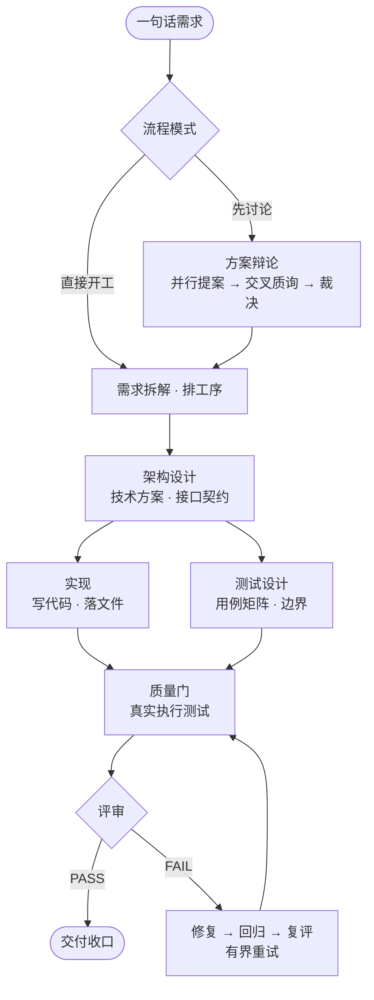

<div align="center">

# AgentForge

**一句话需求，一支会协作的 AI 研发团队。**

规划 · 架构 · 实现 · 测试 · 评审 全流程自动编排：先讨论出方案，再并行落代码，真实跑一遍测试，评审不通过自动返工。产物落在真实工作区，过程在浏览器里逐字可见。

[](https://nodejs.org)


[快速开始](#快速开始) · [工作原理](#工作原理) · [接入本机-cli](#接入本机-cli) · [上下文预算](#上下文预算) · [工作区与工具](#工作区与工具策略) · [HTTP-API](#http-api) · [常见问题](#常见问题)


</div>

---

## 当前版本

本轮把“多智能体协作”从固定流水线推进到可追踪、可重规划、可审计的第一层平台：

- **真实质量门**：CLI 与模拟任务都执行工作区测试入口；没有入口、执行失败或超时都不能交付，并记录真实命令、退出码、耗时与输出。
- **独立评审**：评审候选只允许 `reviewer / tester / architect`，实现者不会被悄悄拉来审自己；自审按真实 `reviewerId / implementerId` 判定并写入任务事件。
- **增量持久化**：流式消息在 200ms dirty 窗口内合并落盘，只重新序列化变化任务；进程正常退出前会 flush 未完成窗口。
- **CLI 解析缓存**：命令解析走进程级缓存，PATH 变化时由探测/刷新接口显式失效，减少热路径同步调用。
- **计划版本**：初版、返工和手动重规划都会生成不可变快照，已完成工序不会被重规划抹掉；自动重规划最多一次，避免无限重试。
- **消息路由**：每条协作消息记录来源、目标、父消息、关联工序、产物引用和 `correlationId`。
- **Tool Gateway 第一层**：平台 API 统一校验工具白名单、执行主体和工作区边界，并记录 `tool.call.start` / `tool.call.end` / `tool.policy.denied`。
- **CLI 执行策略网关**：`strict` 模式把工具白名单映射到 Codex / DSH / Claude 的原生沙箱或工具白名单；无法强制的组合在启动前拒绝，并记录 `cli.policy.*`。
- **六视图工作区控制台**：文件、执行轨迹、计划版本、协作消息、工具审计、Diff 在同一工作区中查看。
- **文件夹开工**：可从本机目录选择器选择已有项目，或使用 Git 隔离工作树并行开工。

## 为什么会有这个项目

把需求丢给单个 AI CLI，你会遇到三个反复出现的坑：

| 坑 | 表现 | AgentForge 的做法 |
| --- | --- | --- |
| **没有分工** | 一个模型既当架构师又当测试，自己审自己 | 5 个角色席位各司其职，评审与实现分离 |
| **不做方案比较** | 第一个念头就是最终方案，硬伤留到交付后 | 先辩论：多方案并行提案 → 交叉质询 → 主持人裁决 |
| **只说不做** | 聊出一堆代码块，没人真正写文件、跑测试 | 每个工序都在真实工作区执行，产物与版本可查 |

而市面上多数「多智能体框架」是**演示品**：内置几个模拟角色，输出像模像样，落到磁盘上是空的。AgentForge 反过来——**默认就用你本机已经装好、真的跑得通的 CLI**，模拟只作为「一个都连不上」时的显式回退，并且每个成员都挂着 `SIM 演示` / `✓ CLI 可用` 徽标，绝不把假输出当成交付。

## 特性

**编排**

- 🧠 **方案辩论先行** — 4 个执行席位 + 1 个工具池 CLI 各出一版方案（契约先行 / 最小闭环 / 测试先行 / 风险优先 / 分阶段交付），互相匿名打 1–10 分并各指一个硬伤，主持人按平均分裁决；只有 1 份有效提案或评分不足时会在裁决里标注置信度，不假装形成共识。
- 🔀 **依赖图并行** — 架构定稿后「实现」与「测试设计」并行推进，DAG 校验依赖与环路，失败按依赖链传播，取消是即时生效而不是等当前工序跑完。
- 🚦 **真实质量门** — 评审前真的执行测试命令，`VERDICT: PASS` 且质量门 `passed` 才允许交付；FAIL 进入「修复 → 回归 → 复评」有界回环，轮次可配。测试入口按 `package.json scripts.test` → Makefile `test` → pytest 配置 → Cargo → Go → `tests/` 探测；没有入口标为 `no-test-entry`，失败或超时同样阻断交付。每次记录真实命令、来源、退出码、耗时和 stdout/stderr，真实 CLI 任务也走同一套质量门。
- 🧑‍⚖️ **独立评审** — 评审候选只允许 `reviewer / tester / architect`，实现者绝不会被悄悄拉来审自己；只有实现席位时评审明确不可用。自审按真实 `reviewerId / implementerId` 判定，身份和 `selfReview` 会写入工序、质量记录与 `review.independence` 事件。
- 🎛 **工作流可视化配置** — 讨论开关与规模、工序并发、全局任务并发、返工轮次都在顶栏 ⚙ 里改，即时落库；另带「快速 / 均衡 / 严谨」三档预设。
- 🔁 **任务级流程覆盖** — 输入框旁可切「先讨论」或「直接开工」，只影响当前任务，不动全局默认。
- 🧭 **计划版本与有限重规划** — 计划以不可变快照保存；失败后自动重规划最多一次，手动重规划会保留已完成工序，方便在复杂项目中继续推进。
- 🔗 **带路由的协作消息** — 消息不再只是聊天记录，还带来源、目标、父子关系、关联工序和产物引用，方便定位“谁把什么交给了谁”。
- 🧰 **Agent 工具白名单与 Tool Gateway** — 每个成员声明可用工具，角色有默认策略，也能按成员覆盖；平台 API 会按 `agentId` 校验权限并写入工具审计。
- 🛡 **真实 CLI 强制策略** — `strict` 会从工具集合推导只读 / 可写边界，覆盖 CLI 参数里的危险沙箱开关；Codex、DSH 映射原生沙箱，Claude 仅允许无 shell 的只读工具白名单，其他组合明确拒绝。
- 🌳 **Git 隔离工作区** — 每个任务可在独立 detached worktree 中执行；Windows 文件系统无法写 worktree 元数据时自动回退 shared clone，源仓库不受影响。

**执行**

- 🖥 **10 个本机 CLI 真接入** — 启动后台并发体检每个 CLI，只有「真回了话且没有鉴权错误」的才占执行席位；同一个 CLI 可兼任多角色（`OpenCode · 架构师`）。
- 🔎 **CLI 解析缓存** — `resolveCommand()` 缓存命令解析结果，避免每次调用都同步跑 `where.exe` / `which`；探测或刷新团队时显式失效，带参数的命令串也能正确提取可执行文件。
- 🔌 **Provider Profile、参数模板与自动回退** — 每个 Agent 可绑定独立 Provider Profile，保存 Base URL、模型、密钥环境变量引用、CLI 参数模板和并发上限；可配置有序备用 Provider，真实 CLI 失败后自动切换并把 `provider.fallback` 写入任务事件流。密钥只从服务进程环境读取，不写入 `db.json`。
- 🧾 **产物带内容版本** — 每个产物记录 `version`（sha256 前 16 位），改写即换版本，可判断「这一步到底动了什么」。
- 🧷 **不合格输出不流转** — 每个角色的回复都要过结构校验：提案需 5 段标题、质询需覆盖全部方案、步骤需可执行产出；半截回复或「我无法完成」直接重试，不把残稿喂给下一步。
- 💾 **原子写入 + 增量持久化** — 临时文件 → `fsync` → `rename`，Windows 占用自动退避重试；流式输出使用 200ms dirty 窗口合并写盘，只序列化变化任务，正常退出前自动 flush。

**界面**

- ⚡ **SSE 实时流** — 逐字输出、Markdown / 表格 / 代码块渲染、阶段条实时高亮、点击工序跳到对应时间线。
- 🗂 **三栏工作台** — 左栏席位与历史，中栏时间线与群聊，右栏上下文 / 辩论记录 / DAG / 产物源码。
- 🖥 **全屏工作区控制台** — 文件树 / 搜索 / 预览 / 编辑、按 Agent 分组的执行泳道、Git diff、上下文预算和工具策略在同一屏查看。
- 🌗 **两套配色** — 顶栏 `SHIFT` 切换日间与夜间。
- 🪟 **桌面模式** — 不打包 Electron，用系统浏览器 `--app` 模式得到独立窗口与任务栏图标，双击即用。

**工程**

- 📦 **零依赖、零构建** — 纯 Node.js + 原生 ESM，`node server/index.mjs` 就起来，前端不打包、不装包管理器。
- ✅ **86 个测试** — `node --test` 直接跑，覆盖并行调度、失败传播、真实质量门、独立评审、持久化 dirty 窗口、可执行文件解析缓存、上下文预算、工作区文件闭环、Git 隔离、工具策略、CLI 强制沙箱映射、计划版本、消息路由、Tool Gateway 审计、Provider Profile、CLI 参数模板、Provider 自动回退、全局调度队列、Agent 租约、真实工时统计、输出完整性判定与退出码分类。

## 快速开始

要求 **Node.js ≥ 20.11**，没有任何其他依赖。

```bash
git clone https://github.com/liuzheng6621/super-agentbot.git
cd super-agentbot
npm start
```

打开 <http://127.0.0.1:8787>，在底部输入框描述需求，`Ctrl / ⌘ + Enter` 开工。

首次启动会自动生成：

```
data/db.json                 团队、任务、设置、Webhook Token
data/workspaces/<taskId>/    每个任务的真实工作区（产物就在这里）
data/spill/<taskId>/         超长上游产物的落盘副本
```

> **Windows 一键**：双击 `安装到桌面.bat`，桌面与开始菜单会出现 `AGENTFORGE` 快捷方式，双击开窗、关窗回收。

## 工作原理



每一轮工序都走同一条链路：

```
组装上下文（稳定区 + 易变区） → 调 CLI（真实子进程） → 抓 stdout
   → 对比工作区快照（size + 纳秒 mtime + 内容版本） → 收录产物 → 落 Session 事件
```

### 五个执行席位

| 角色 | 职责 | 典型产出 | 默认偏好顺序 |
| --- | --- | --- | --- |
| `planner` | 拆需求、排工序、收口 | 任务分解、交付结论 | claude → dsh → qwen → gemini |
| `architect` | 技术方案、接口契约 | 设计文档 | gemini → claude → dsh → kimi |
| `coder` | 落代码、写文件 | 源码文件 | codex → opencode → trae-cli → dsh |
| `tester` | 用例矩阵、回归验证 | 测试用例、缺陷单 | opencode → crush → codex → gemini → dsh |
| `reviewer` | 评审、PASS / FAIL 质量门 | 评审意见 | dsh → claude → kimi → qwen → gemini |

席位采用 **主执行人 + 工具池**：每个角色只有一个主执行人，多接的 CLI 留在池里随时可上位。角色可增删改，提示词、命令、参数都能在界面上编辑。

## 接入本机 CLI

左栏「扫描本机 CLI」用 `where.exe` / `which` 确认命令存在并读版本；启动后台还会对每个已安装 CLI **真发一条最短提示词**（`Reply with exactly: OK`）做体检，判定标准是「有回复 + 没有鉴权错误」，而不是「进程退出码为 0」——因为很多 CLI 失败时也返回 0。

已实测跑通（Windows，统一指向本地网关）：

| CLI | 调用方式 | 免审批参数 | prompt 传递 | 体检耗时 |
| --- | --- | --- | --- | --- |
| `claude` | `.exe` 直连 | `--permission-mode bypassPermissions` | argv | ≈ 7s |
| `codex` | `.exe` 直连 | `--sandbox workspace-write` | argv | ≈ 17s |
| `opencode` | `.cmd` | `run --auto` | stdin | ≈ 11s |
| `dsh` | `.cmd` | `--permission-mode workspace-write --approval-policy never` | stdin | ≈ 30s |
| `kimi` | `.cmd` | —（打印模式不接受 `--auto`） | argv | ≈ 8s |
| `trae-cli` | `.exe` 直连 | `run --config-file …` | argv | ≈ 14s |
| `crush` | `.exe` 直连 | `run -y` | stdin | ≈ 28s |
| `aider` | `.exe` 直连 | `--yes` | argv | ≈ 16s |
| `gemini` | `.cmd` | `--skip-trust --approval-mode yolo` | stdin | ≈ 7s |
| `qwen` | `.cmd` | `--approval-mode yolo` | stdin | ≈ 20s |

三条踩过的坑，写在这里省你几小时：

1. **非交互必须显式免审批**。`-p` / `exec` 模式下没有人在旁边点「允许」，写文件会被权限层拦下，模型会回一句「我无法绕过权限」然后什么都没做。
2. **`.cmd` 包装器经 `cmd.exe` 时，多行 prompt 的换行会被当成命令分隔符**，后面的参数被吞掉（典型症状：`gemini` 报 `not running in a trusted directory`、退出码 55）。所以 `.cmd` 系一律把 prompt 走 **stdin**，只有 `kimi` 因为 `-p` 与 `--auto` 互斥而保留 argv——代价是它只适合单行任务。
3. **「装了」≠「能用」**。装了没配 Key、网关返回 405、provider 未初始化，都会在体检里被判不可用，不会混进团队。

常见不通过的对照表：

| 体检输出 | 原因 | 处理 |
| --- | --- | --- |
| `API Error: 405 / 401` | 网关地址或凭据不对 | 修正该 CLI 的 base URL / Key |
| `Please set an Auth method` / `No auth type` | 未配置 API Key | 补 `GEMINI_API_KEY`、qwen 的 `--auth-type` 等，再点「体检并换真实席位」 |
| `No providers configured` / `No LLM` | provider 未初始化 | 先跑一次该 CLI 的交互式初始化 |
| `Config file not found` | 缺配置文件 | 用 `--config-file` 指定，或写进参数模板 |
| 超时无输出 | 首次拉模型 / 不支持一次性提示词 | 单独点成员 ⚙ 或 `POST /api/agents/:id/test` 用更长超时复测 |

体检结果写进 `data/db.json` 的 `settings.teamHealth`，二次启动几乎零等待；改了 Key 就点左栏「体检并换真实席位」强制重检。

### 调用层的四道兜底

CLI 是不可控的第三方进程，所以调用不是「起进程 → 收字符串」这么简单：

| 机制 | 做法 | 解决什么 |
| --- | --- | --- |
| **参数拼装** | `normalizeCliArgs()` 给 `gemini` 补 `--prompt=`，给 `trae-cli run` 补 `--max-steps 16 --console-type simple`；命令行拼接时逐项加引号 | CLI 参数约定各不相同；路径含空格（`Program Files`）时不会被拆成两个参数 |
| **退出码分类** | `classifyCliExit()` 把退出码映射成 成功 / 执行超时 / 已停止 / 命令缺失 / 启动失败 / Windows 初始化失败（`0xC0000142`）/ 外部终止，并标出是否可重试 | 「退出码 0 = 成功」不成立；`0xC0000142` 这类系统级失败要能和真实业务失败区分 |
| **输出完整性** | `isCompleteProposalText()` / `isCompleteCritiqueText()` / `isCompleteStepText()` / `isCompleteSummaryText()` / `isCompleteDecisionText()` 按角色校验结构（提案需 5 段标题、质询需覆盖全部方案、步骤需可执行产出），不合格自动重试 | CLI 经常「退出码 0 但只回半段」「回一句无法完成」；这种产出若直接进下一步，后面全盘皆错 |
| **运行时 PATH** | `runtimePathEnv()` 把 Node 自身目录与 npm / WinGet / Programs 等常见 bin 目录补进子进程 PATH | 从桌面快捷方式启动时继承的 PATH 残缺，`claude.cmd` 之类会报「找不到命令」 |

### 与 Magpie 的关系

AgentForge **不是基于 Magpie 框架实现**。Magpie 目前只是部分 CLI 适配器中的默认兼容网关：`server/adapters.mjs` 仍为 Codex、Aider、Gemini、Qwen 等命令保留 `http://127.0.0.1:3425`、模型名或环境变量的默认值。

现在 Provider Profile 已把 Base URL、模型、密钥环境变量引用、CLI 参数模板和并发上限带到配置层，Agent 可以绑定主 Provider 与有序备用 Provider；执行时会解析成临时子进程环境，失败后在同一工序内自动切换，不把明文密钥写回持久化数据。

真实 CLI 的工具边界由 Agent 的 `executionPolicy` 控制：`inherit` 保持兼容，`strict` 会按工具白名单选择 CLI 原生沙箱。当前能可靠表达的组合是 Codex / DSH 的只读或工作区可写沙箱，以及 Claude 无 shell 的只读工具白名单；无法证明的边界会返回 `-6` 并写入 `cli.policy.denied`，不会启动子进程。完整设计见 [docs/agent-platform-roadmap.md](docs/agent-platform-roadmap.md)。

## 上下文预算

多工序流水线最容易悄悄变贵的地方是上下文。这里的四条规则都带测试守护：

| 机制 | 做法 | 为什么 |
| --- | --- | --- |
| **段序稳定** | prompt 拆成 `stableBlock`（目标 / 工作区）与 `volatileBlock`（状态 / 工序账本 / 文件清单）；稳定区永远在前，易变区压到末尾 | 易变块放开头会让**前缀缓存全灭**，每步都按全价重算 |
| **输入输出双向 token 记账** | `server/tokens.mjs` 按字符类估算：CJK 1.0 / ASCII 1/3.6 / 其他 1/2；`store.countPrompt()` 在发请求前先记提示词，`appendMessage()` 记流式输出，落成 `stats.tokensIn` / `tokensOut` | 只算输出会把成本低估一个数量级（实测同一任务输入 4319 / 输出 7187）；用 `len/3` 估中文还会再低估约 3 倍 |
| **原子写 + 内容版本** | `server/fs.mjs`：同级临时文件 → `fsync` → `rename`；`versionOf()` 取 sha256 前 16 位 | 半截文件不可接受；等长改写也要能识别出来 |
| **超长产物 spill** | 上游产物超过 8000 字落 `data/spill/<taskId>/`，prompt 里只放「只读路径 + 1600 字摘录」 | 直接 `clip` 丢掉中间 25% 是**不可恢复**的信息损失 |

设计依据与完整取舍写在 [docs/design-io-image-context.md](docs/design-io-image-context.md)。

## 工作区与工具策略

工作区控制台不是静态文件列表，而是把“文件、执行、审查”放在同一条任务链路里：

| 视图 | 能做什么 |
| --- | --- |
| **文件** | 浏览工作树、搜索内容、预览文本/二进制状态、编辑保存、新建、移入回收站 |
| **执行泳道** | 按 Agent 分组显示工序、依赖数、运行状态和尝试次数；事件流记录工具调用、文件变更和运行结果 |
| **Diff** | 对比 Git `HEAD`，并补齐未跟踪新文件的 unified diff；敏感、二进制和超限文件有保护 |
| **上下文 / 策略** | 展示注入的消息与文件预算、最近协作、已知文件、工具白名单，以及 `INHERIT / STRICT / BLOCKED` 执行策略状态 |

平台文件操作覆盖查、增、改、移、删，并统一经过 Tool Gateway 第一层：

- 路径必须是工作区内相对路径；拒绝 `..`、绝对路径和符号链接。
- `.git`、`.agentforge` 不允许通过文件 API 直接读写。
- `.env*`、私钥、`.npmrc`、`.pypirc` 等敏感文件禁止预览和平台写入。
- 写入使用临时文件 + `fsync` + `rename`，并记录前后内容版本。
- 删除进入 `.agentforge/trash`，不是不可恢复的硬删除。
- Agent 调用会校验工具白名单，并记录 `tool.call.start` / `tool.call.end` / `tool.policy.denied`；Owner 写操作同样留痕。
- Owner UI 的只读请求不写入工具审计，避免“刷新工作区 → 产生审计事件 → 再次刷新”的反馈循环。
- `executionPolicy=strict` 时，真实 CLI 必须在启动前通过策略预检；Codex / DSH 使用原生沙箱，Claude 使用只读工具白名单，其他命令或无法精确表达的组合返回 `-6`，不会放行。
- 每次 CLI 调用会记录 `cli.policy.start` / `cli.policy.end` / `cli.policy.denied`，消息元数据包含实际策略、沙箱、边界和拒绝原因。
- `executionPolicy=inherit` 仍保留兼容行为：CLI 可以绕过平台 API 使用自身工具，界面会明确标记 `INHERIT`，不把平台 API 校验冒充子进程隔离。
- 平台 `shell` 端点当前明确返回 `501`，不会把未执行的命令伪装成成功。

Git 隔离支持两种模式：

- `worktree`：`git worktree add --detach`，每个任务独立目录，删除任务时只清理工作树。
- `clone`：当 Windows 文件系统无法写 `.git/worktrees` 时自动回退到 `git clone --shared`，并在界面标记 `CLONE 回退`。

同一进程内可以并行运行多个任务，每个任务使用独立工作区。全局 Scheduler 会限制同时运行的任务数，按 Provider 计算并发配额，并为显式声明的 Agent 获取租约；排队任务会显示队列位置和等待原因。Agent 可声明主 Provider 与备用 Provider，CLI 失败会在同一工序内回退并记录事件。尚未实现工作区池、磁盘配额、任务优先级和 Provider 级费用预算，详见路线图。

## 界面

三栏工作台，所有状态由 SSE 推送，无轮询。

| 区域 | 内容 |
| --- | --- |
| **左栏** | 五个执行席位 + 工具池（在线状态、`SIM 演示` / `✓ CLI 可用` / `! 不可用`）、本机 CLI 扫描结果、「体检并换真实席位」、历史任务 |
| **中栏** | 工作流阶段条（讨论 → 拆解 → 架构与实施 → 评审 → 交付，实时高亮负责人，可点击跳转）、按阶段分隔的协作时间线、流式输出、方案 / 质询 / 裁决标签、底部群聊输入框 |
| **右栏** | 上下文包、方案讨论（提案人 / 评分 / 票数 / 胜出方案 / 质询记录）、DAG 链路（依赖 / 并行 / 尝试次数 / 返工）、产物源码、统计与 Bot Hook |
| **全屏工作区控制台** | 左侧工作树与变更；中间六视图：文件 / 执行轨迹 / 计划版本 / 协作消息 / 工具审计 / Diff；右侧上下文与 Agent 工具策略；桌面和移动端都可直接进入 |
| **统计面板** | 每个数字都来自落库事实：累计 TOKENS = 各成员 token 之和（输入与输出分开记账，`tokensIn` / `tokensOut`，不把成本低估一个数量级）；协作轮次 = 真实调用成员次数 `stats.agentRuns`；产物文件 = 产物清单条数；返工轮次 = `repairRound`；总耗时 = 各工序实际耗时之和（墙钟含排队与重试等待，只作悬浮提示）；质量门 = `passed / failed / timeout / no-test-entry / running / skipped / not-run` 等状态，中断的任务不会永远停在「待执行」 |
| **顶栏** | 状态、⚙ 工作流设置、`SHIFT` 切换配色 |

群聊里一次 `@` 多位成员，会自动组成讨论组出方案——这是「临时开个小会」的最短路径。

## 桌面模式

| 能力 | 实现 |
| --- | --- |
| 无控制台窗口 | `wscript` 隐藏启动 `desktop/launcher.mjs` |
| 独立应用窗口 | Edge / Chrome `--app` 模式，无地址栏、独立任务栏图标 |
| 隔离浏览器配置 | `%LOCALAPPDATA%\AgentForge\browser` |
| 单实例 | 已运行时直接开窗复用，不重复起服务 |
| 退出回收 | 关窗即结束服务并清理运行时锁 |
| 图标生成 | `desktop/make-icon.mjs` 纯 Node 生成 PNG / ICO |

日志在 `%LOCALAPPDATA%\AgentForge\logs\`，业务数据仍在项目内 `data/`。卸载：`卸载桌面快捷方式.bat` 或 `node desktop/install.mjs --remove`。

## HTTP API

所有接口都在 `http://127.0.0.1:8787` 下，JSON in / JSON out，无需鉴权（默认只监听本机回环）。

| 方法 | 路径 | 说明 |
| --- | --- | --- |
| `GET` | `/api/state` | 全量状态（团队 / Provider / 任务 / 设置 / Scheduler / 当前任务） |
| `GET` | `/api/scheduler` | 全局队列、运行任务、Provider 配额和 Agent 租约 |
| `GET` `POST` | `/api/providers` | Provider Profile 列表 / 新增 |
| `PATCH` `DELETE` | `/api/providers/:id` | 修改 / 删除 Profile（`local-default` 不可删除） |
| `GET` | `/api/tools` | 工具目录、输入 Schema、执行策略与 CLI 适配能力 |
| `GET` | `/api/cli-policy?policy=&command=&tools=` | 预览某组工具和命令能否被严格强制 |
| `PATCH` | `/api/settings` | 工作流参数（白名单字段 + 范围夹紧） |
| `POST` | `/api/tasks` | 创建 `{ goal, workspace?, isolation?: "direct"\|"worktree", flowMode?: "debate"\|"direct", autoRun? }` |
| `GET` | `/api/tasks/:id` | 任务详情（消息、工序、产物、计划版本、工具审计） |
| `POST` | `/api/tasks/:id/run` | 重新编排，可带 `{ flowMode }` |
| `POST` | `/api/tasks/:id/stop` | 停止执行 |
| `POST` | `/api/tasks/:id/chat` | `{ text }` 群聊，支持 `@成员名` |
| `POST` | `/api/tasks/:id/replan` | 重规划未完成工序，可带 `{ reason?, steps? }` |
| `GET` | `/api/tasks/:id/tools` | 当前任务的工具目录与工具事件 |
| `GET` | `/api/tasks/:id/files` | 工作区文件列表（含字节数与纳秒 mtime） |
| `GET` | `/api/tasks/:id/file?path=` | 读取单个文件 |
| `GET` | `/api/tasks/:id/workspace` | 工作区树、变更、事件、摘要与 Git 信息 |
| `GET` | `/api/tasks/:id/search?q=` | 工作区全文搜索 |
| `GET` | `/api/tasks/:id/events?limit=` | 任务事件流（工具调用 / 文件变更 / 运行结果） |
| `GET` | `/api/tasks/:id/changes` | 文件变更账本 |
| `GET` | `/api/tasks/:id/diff?path=` | 对比 `HEAD` 的 unified diff（含未跟踪文件） |
| `POST` | `/api/tasks/:id/fs` | `{ op: "write"\|"mkdir"\|"move"\|"delete", path/from/to, content?, agentId? }` |
| `POST` | `/api/context-preview` | `{ goal, workspace? }` 预览上下文包 |
| `GET` `POST` | `/api/agents` | 团队列表 / 新增成员 |
| `PATCH` `DELETE` | `/api/agents/:id` | 修改 / 移除成员 |
| `POST` | `/api/agents/:id/test` | 单 CLI 连通性冒烟（60s 超时） |
| `POST` | `/api/agents/adopt` | 扫描并接入可用 CLI 到工具池 |
| `POST` | `/api/agents/rebalance` | 按角色偏好重新分派席位 |
| `POST` | `/api/team/ensure` | 探测 + 体检 + 换真实席位（幂等） |
| `POST` | `/api/team/refresh` | 强制重新体检并重组 |
| `GET` | `/api/probe` | 扫描本机 CLI |
| `GET` | `/api/fs?path=` | 浏览本机目录（「选文件夹开工」） |
| `GET` | `/api/stream` | SSE 事件流 |
| `GET` | `/api/health` | 健康检查（含 Scheduler 快照） |
| `POST` | `/api/shutdown` | 优雅退出 |
| `POST` | `/api/hooks/:token` | 外部触发（Bot Hook） |

工作区读取接口支持可选的 `agentId` 查询参数；传入后会校验该 Agent 是否拥有 `workspace.read` / `workspace.search`。`/fs` 写入、移动、删除同样校验对应工具。

### Bot Hook

一次 POST 就能让流水线开工，接机器人、CI 或自建系统：

```bash
curl -X POST http://127.0.0.1:8787/api/hooks/<token> \
  -H "Content-Type: application/json" \
  -d '{"goal":"做一个并发安全的待办 API"}'
```

Token 在界面右侧「统计」面板，或 `data/db.json` 的 `settings.hookToken`。

## 配置

| 变量 | 默认值 | 说明 |
| --- | --- | --- |
| `PORT` | `8787` | HTTP 端口（被占用时会打印明确提示并以退出码 2 退出，不会静默失败） |
| `HOST` | `127.0.0.1` | 监听地址；局域网共享设 `0.0.0.0` |
| `AGENTFORGE_DATA_DIR` | `<repo>/data` | 数据目录，测试与多套数据隔离时用 |
| `AGENTFORGE_MODEL` | `trae-cn/glm-5.3-flash` | 全局模型名兜底；Agent 绑定的 Provider Profile 可覆盖模型和 Base URL |

工作流参数（讨论开关与规模、工序并发、全局任务并发、返工轮次）在界面 ⚙ 里改，落 `data/db.json` 的 `settings`。Provider Profile 在左栏「Provider 配置」或 `/api/providers` 管理；`apiKeyRef` 只保存环境变量名，真实值由服务进程环境提供。`cliBindings` 按命令名保存参数模板，可用 `{{model}}`、`{{baseUrl}}`、`{{apiKey}}`、`{{providerId}}`、`{{providerName}}` 和 `{{env:NAME}}`；Agent 的 `fallbackProviderIds` 决定备用顺序。

## 项目结构

```
.
├── server/
│   ├── index.mjs         HTTP 路由、SSE、静态资源、单实例端口守卫
│   ├── orchestrator.mjs  流水线编排、质量门、上下文组装、产物落盘
│   ├── scheduler.mjs     全局任务队列、Provider 配额与 Agent 租约
│   ├── providers.mjs     Provider Profile、密钥引用解析与执行环境
│   ├── cli-policy.mjs    工具能力推导、CLI 沙箱映射与严格策略预检
│   ├── store.mjs         状态、席位、持久化、事件总线
│   ├── collaboration.mjs 计划版本、消息信封与路由差异
│   ├── tool-gateway.mjs  工具白名单、主体校验与调用审计
│   ├── workspace.mjs     工作区树、读写、搜索、回收站、Diff、路径边界
│   ├── dag.mjs           依赖图校验与并行调度
│   ├── adapters.mjs      CLI 适配（argv / stdin / 免审批参数）、模拟流式、本机探测
│   ├── team.mjs          体检判定与真实席位组建
│   ├── fs.mjs            原子写入、内容版本、超长文本 spill
│   ├── tokens.mjs        中文感知的 token 估算
│   ├── adopt.mjs         本机 CLI 扫描与接入
│   └── sim.mjs           内置内容引擎（仅回退用）
├── public/               前端（原生 ESM，无构建）
│   ├── index.html
│   ├── styles.css
│   ├── app.js            SSE 客户端与渲染
│   └── fonts/            自托管字体（离线可用）
├── desktop/              桌面启动器、快捷方式安装、图标生成
├── docs/
│   ├── screenshot.png
│   ├── design-io-image-context.md
│   └── agent-platform-roadmap.md
├── tests/                13 个测试文件、86 个测试
├── 安装到桌面.bat
├── 卸载桌面快捷方式.bat
└── data/                 运行时数据（gitignore）
```

## 测试

```bash
npm test
```

86 个测试，覆盖：依赖图并行 / 失败传播 / 环路检测 / 取消即时性、五席位分工、完整协作链路、质量门返工、CLI 失败禁止误交付、停止竞态、评审结论解析、辩论评分与排名规则、工作流设置白名单与任务级流程覆盖、真实团队体检判定与席位挑选、质量门测试入口探测与 `no-test-entry` 判定、真实 CLI 任务同样执行质量门、独立评审与自审身份判定、目录快照复用、上游瞬时故障（ECONNRESET / 429 / socket hang up）只重试一次且不掩盖真实失败、上下文预算（段序稳定性、中文 token 估算、原子写版本、spill 可还原）、工作区文件闭环与路径/敏感文件边界、Agent 工具策略、CLI 强制沙箱映射与拒绝事件、计划版本与已完成工序保留、消息路由、Tool Gateway 权限与审计、Provider Profile 持久化与迁移、CLI 参数模板渲染、Provider 路由与真实子进程回退、全局任务并发、Provider 配额、Agent 租约与排队取消、Git worktree 隔离与 shared clone 回退、未跟踪文件 Diff、真实工时统计（只累加结束过的工序，不拿墙钟冒充）、输出完整性判定（半截提案 / 缺段质询 / 空步骤都会判不合格）、提案宽松解析（`A=7`、`B：8分`、`方案 C 7/10`）、退出码分类（超时 / 已停止 / 命令缺失 / 策略拒绝 / `0xC0000142`）与参数拼装、dirty 窗口合并落盘、退出前 flush、可执行文件解析缓存。

## 已知边界

- **单机单进程**：状态存 JSON 文件，适合本地个人与内网演示；要多实例请替换 `store.mjs` 的持久化实现。
- **`kimi` 只适合单行任务**：`-p` 与 `--auto` 互斥，只能走 argv，多行 prompt 会被 `cmd.exe` 截断。
- **`trae-cli` 的行为取决于模型**：工具齐全（bash / 编辑 / 顺序思考），但某些模型只肯调顺序思考而不落盘——这是模型行为，不是配置问题。
- **模拟模式**：一个可用 CLI 都没有时才会启用，产出仍是可运行的代码（`tests/*.test.js` 能直接 `node` 执行），但成员会明确标注 `SIM 演示`。
- **CLI 严格策略是原生能力映射，不是内核级代理**：`strict` 只放行 Codex / DSH / Claude 能明确表达的组合，并覆盖参数里的危险开关；`inherit` 仍允许 CLI 使用自身工具。真正的网络代理、文件租约和跨进程系统调用拦截仍待后续。
- **Magpie 只是默认网关**：项目不依赖 Magpie 框架；Provider Profile、密钥引用、CLI 参数模板、自动回退和 CLI 严格策略已落地。
- **调度粒度仍是任务级**：全局任务并发、Provider 配额和显式 Agent 租约已生效；Provider 配额按绑定该 Provider 的活跃任务计数，不按每次 CLI 调用计数。工作区/磁盘配额和任务优先级仍在路线图中。

## Roadmap

- [x] 真实 CLI 体检组队（10 个 CLI 实测跑通）
- [x] 方案辩论、DAG 并行、真实质量门返工
- [x] 独立评审（禁止实现者自审）
- [x] dirty 窗口增量持久化与退出前 flush
- [x] CLI 可执行文件解析缓存
- [x] 上下文预算（段序 / token 估算 / 原子写 / spill）
- [x] 工作区文件闭环、全屏控制台、执行泳道与 Diff
- [x] Agent 工具白名单与 Git worktree/clone 隔离
- [x] 计划版本、有限重规划、带路由消息与 Tool Gateway 第一层
- [x] CLI 严格策略网关（Codex / DSH 原生沙箱、Claude 只读白名单、无法强制时拒绝）
- [ ] 内核级 CLI 代理网关（统一网络、文件租约与系统调用审计）
- [ ] 文件租约、跨 Agent 写冲突检测与事务级回滚
- [x] Provider Profile（自定义网关、密钥环境引用、Agent 绑定与并发配额）
- [x] 全局 Scheduler（任务并发、Provider 配额、Agent 租约）
- [x] Provider 自动路由与回退、CLI 参数模板
- [ ] 工作区池、磁盘配额与任务优先级
- [ ] 跨任务工作区总览、DAG 图与时间回放
- [ ] 附件与读图（把截图交给视觉模型看 UI）
- [ ] 读后写守卫（改动未经读取的文件时要求先读，防盲改）
- [ ] 正规压缩（长任务的摘要式上下文压缩）
- [ ] 多实例持久化后端

## 常见问题

<details>
<summary><b>体检全失败，界面全是 SIM 演示？</b></summary>

说明本机没有能跑通的 CLI，或者都还没配 Key。先手动跑一次，看真实报错：

```bash
claude -p "Reply with exactly: OK"
gemini -p "Reply with exactly: OK" --skip-trust
```

按上面的对照表修完，点左栏「体检并换真实席位」（或 `POST /api/team/refresh`）强制重检。
</details>

<details>
<summary><b>启动报「端口 8787 已被占用」？</b></summary>

多半是已经有一个 AgentForge 在跑。关掉旧进程，或换端口：`PORT=9000 npm start`。
</details>

<details>
<summary><b>怎么把所有 CLI 指向自己的网关或模型？</b></summary>

设 `AGENTFORGE_MODEL`，例如 `AGENTFORGE_MODEL=my-gateway/my-model npm start`。也可以为每个 Provider Profile 配置 `baseUrl`、`model`、`apiKeyRef` 和 `cliBindings`；参数模板会把模型、网关、密钥引用和 prompt 解析到子进程环境或参数里，无需修改源码。
</details>

<details>
<summary><b>数据存在哪？能备份吗？</b></summary>

全在 `data/`：`db.json` 是团队 / 任务 / 设置，`workspaces/<taskId>/` 是每个任务的真实产物。整个目录拷走即是完整备份，删掉即是从零开始。
</details>

<details>
<summary><b>能局域网多人用吗？</b></summary>

`HOST=0.0.0.0 npm start` 即可，但注意它**没有鉴权**，只适合可信内网。多实例共享状态需要替换 `store.mjs` 的持久化实现。
</details>

<details>
<summary><b>我的代码会被上传到哪？</b></summary>

服务本身只在你指定的工作区读写文件，不外传。但每个工序都会把上下文（目标、上游产物摘录、文件清单）发给你所选 CLI 背后的模型服务商——隐私边界取决于你用的是哪家模型，用本地网关就是本地。
</details>

## 贡献

欢迎 issue 与 PR。两条底线：

1. **保持零依赖**——新增运行时依赖的 PR 会被要求改成手写实现。
2. **`npm test` 必须全绿**——新增行为请带测试，测试即验收判据。

## License

[MIT](LICENSE)

<div align="center">

如果这个项目帮你省下了一次「AI 说做完了但其实什么都没写」，点个 ⭐ 让更多人少踩一遍。

[](https://star-history.com/#liuzheng6621/super-agentbot&Date)

</div>
